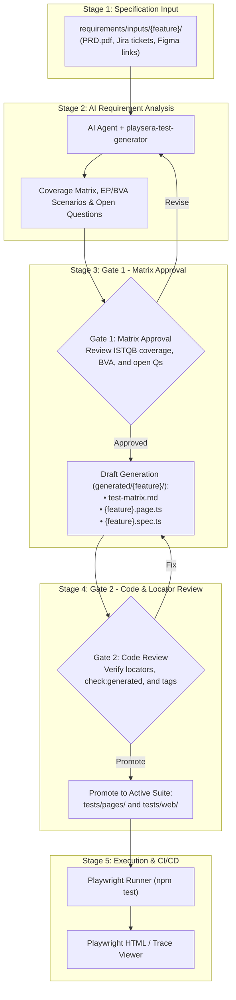

# Playsera Web & API Test Automation Framework 🎭

Enterprise-grade test automation boilerplate for **Web Applications** and **REST APIs**, combining **Playwright Test (@playwright/test)**, **TypeScript**, **Page Object Model (POM)**, **Smart Contract Locators**, and an agentic test design generator (`playsera-test-generator`).

Designed for AI-assisted test authoring with shift-left quality gates, ISTQB traceability, and seamless CI/CD integration.

> [!TIP]
> 🤖 **New to AI-Assisted QA?** Refer to the [How to Trigger in Chat](#-how-to-trigger-in-chat--cara-memanggil-di-chat) section below for dual-language prompt templates (English & Indonesian), worked examples, approval workflows, and tag cheatsheets.

---

## 🌐 Platform Support & Engine Readiness

| Channel / Engine | Runner | Status | Capabilities & Notes |
| :--- | :--- | :---: | :--- |
| **Desktop Chromium** | Playwright (Chrome / Edge) | 🟢 Ready | Native fast execution, tracing, network mocking, and HAR recording. |
| **Desktop Firefox** | Playwright (Gecko) | 🟢 Ready | Cross-browser compatibility and web standards verification. |
| **Desktop WebKit** | Playwright (Safari engine) | 🟢 Ready | macOS & Safari browser rendering engine verification. |
| **Mobile Web** | Playwright Emulation (Pixel / iPhone) | 🟢 Ready | Viewport, touch events, and user-agent emulation for mobile responsive web. |
| **REST API** | Playwright `APIRequestContext` | 🟢 Ready | Contract testing, status code assertions, and hybrid UI data seeding. |

---

## 📋 Prerequisites

Ensure your development machine has the following tools installed before running tests:

| Tool / Dependency | Required Version | Verification Command | Notes & Environment Variables |
| :--- | :--- | :--- | :--- |
| **Node.js** | `>= 20.0.0` | `node -v` | Active LTS recommended |
| **npm** | `>= 10.0.0` | `npm -v` | Installed with Node.js |
| **Playwright Browsers** | Latest (`1.52+`) | `npx playwright --version` | Install binaries via `npx playwright install` |
| **VS Code** *(Optional)* | Latest | `code -v` | Recommend installing the official "Playwright Test for VSCode" extension |

---

## ⚡ Quick Start

```bash
# 1. Navigate to the repository
cd ~/Documents/playsera-automation

# 2. Install dependencies & initialize configuration
npm install
cp .env.example .env

# 3. (Optional) Install browser binaries if not already cached
npx playwright install chromium

# 4. Run the automated smoke suite
npm run test:smoke

# 5. Open interactive Playwright UI Dashboard
npm run test:ui
```

### Expected Terminal Output (Sample):
```text
Running 3 tests using 1 worker

  ✓  1 [chromium] › tests/web/sample-login/login.spec.ts:12:3 › User logs in successfully with valid credentials (1.2s)
  ✓  2 [chromium] › tests/web/sample-login/login.spec.ts:19:3 › Show error alert when password is incorrect (850ms)
  -  3 [chromium] › tests/web/sample-login/login.spec.ts:28:3 › Account lockout after consecutive failed attempts (skipped)

  2 passed, 1 skipped (2.5s)

To open the last HTML report run:
  npx playwright show-report
```

---

## 📑 Table of Contents
1. [Architecture & Workflow](#architecture--workflow)
2. [End-to-End Workflow Table](#end-to-end-workflow-table)
3. [How to Trigger in Chat (Bilingual)](#-how-to-trigger-in-chat--cara-memanggil-di-chat)
4. [Environment Configuration (.env)](#environment-configuration-env)
5. [Test Tag Taxonomy](#test-tag-taxonomy)
6. [Running Tests & Reports](#running-tests--reports)
7. [Smart Contract Locators & Shift-Left QA](#smart-contract-locators--shift-left-qa)
8. [Automated Requirement Extraction](#automated-requirement-extraction)
9. [Troubleshooting & FAQ](#troubleshooting--faq)
10. [Project Directory Structure](#project-directory-structure)

---

## Architecture & Workflow

The framework enforces two human approval gates to ensure AI generates high-quality, verified tests that never break existing test suites:



---

## End-to-End Workflow Table

| # | Step | Description | Primary Output |
| :-: | :--- | :--- | :--- |
| **1** | **Gather Inputs** | Place raw PRD (`.pdf`, `.docx`), Jira ticket notes, or Figma links into `requirements/inputs/{feature}/`. | Raw files ready in staging |
| **2** | **AI Requirement Analysis** | Ask the agent to analyze the requirement. The AI enumerates positive/negative/BVA scenarios and lists open questions. | Test matrix & clarifying questions |
| **3** | **Gate 1: Matrix Approval** | Review `test-matrix.md`, answer any blocking open questions, and reply **`Approved`** (or **`Setuju`**). | Scope and business logic confirmed |
| **4** | **Draft Generation** | The AI writes `<feature>.page.ts` and `<feature>.spec.ts` into safe staging folder `generated/{feature}/`. | Working draft code in staging |
| **5** | **Gate 2: Locator Verification** | Verify element locators against live web app via browser DevTools or `npx playwright codegen`. | Verified locators |
| **6** | **Static Quality Gate** | Run mechanical draft checker: `npm run check:generated -- generated/<feature>`. | Verified compilation & tags (0 errors) |
| **7** | **Promotion to Production** | Move files from `generated/<feature>/` into official test suite (`tests/pages/` and `tests/web/`). | Production test suite |
| **8** | **Lint & Typecheck** | Verify global repository integrity: `npm run lint:tags && npm run typecheck`. | Verified compilation & tags |
| **9** | **Automated Execution** | Execute automated test runs: `npm run test:smoke` or `npm run test:regression`. | Test execution results |
| **10** | **Report & Debugging** | Inspect execution trace, screenshots, and network logs: `npm run test:report`. | Playwright HTML & Trace report |

---

## 💬 How to Trigger in Chat / Cara Memanggil di Chat

### 🇬🇧 English
Simply mention:
- *"Help me generate Playwright test cases for this login requirement..."*
- *"Create a test design and spec for the checkout feature below..."*
- *"Analyze the PRD in requirements/inputs/onboarding/PRD.pdf and generate its test suites..."*
- *"Run full mode to generate both test-matrix.md and playwright spec in one go."*

### 🇮🇩 Bahasa Indonesia
Cukup ketik perintah seperti:
- *"Bantu generate test case Playwright untuk requirement login ini..."*
- *"Buat test design dan spec untuk fitur checkout berikut..."*
- *"Analisis PRD di requirements/inputs/onboarding/PRD.pdf lalu generate test suites-nya..."*
- *"Langsung generate semuanya sekali jalan (mode full) untuk fitur payment..."*

---

## Environment Configuration (.env)

All runtime parameters are configured through `.env`. Use `.env.example` as your template:

| Category | Key | Required | Default / Example | Purpose |
| :--- | :--- | :---: | :--- | :--- |
| **Web** | `BASE_URL` | Optional | `https://example.com` | Base URL for Web browser automation |
| | `HEADLESS` | Optional | `true` | Toggle headless mode (`false` shows visual browser) |
| **API** | `API_BASE_URL` | Optional | `https://api.example.com` | Base URL for REST API test project |
| | `API_KEY` | Optional | `your_api_key` | Bearer token / API authorization key |
| **Credentials** | `TEST_USER_EMAIL` | Optional | `user@example.com` | Standard test user account |
| | `TEST_USER_PASSWORD` | Optional | `Secret123!` | Standard user password |
| | `TEST_ADMIN_EMAIL` | Optional | `admin@example.com` | Administrator test user account |
| | `TEST_ADMIN_PASSWORD` | Optional | `AdminPass123!` | Administrator password |
| **CI / Runner** | `CI` | Optional | `false` | Enables CI settings (retries, single worker, forbid only) |

> [!CAUTION]
> **Security Guardrail**: Never commit `.env` or personal credentials to Git. Ensure `.env`, `.env.*`, and `test-results/` are listed inside `.gitignore`.

---

## Test Tag Taxonomy

Every Playwright test scenario must declare tags in its metadata for CI filtering and auditability. Validate compliance anytime using `npm run lint:tags`.

| Category | Tag | Description & Usage Example |
| :--- | :--- | :--- |
| **Traceability** | `@REQ-<KEY>` | Maps scenario to requirement documentation key (e.g. `@REQ-AUTH-01`) |
| | `@AC-xx` | Maps scenario to Acceptance Criterion (e.g. `@AC-01`) |
| | `@JIRA-<KEY>` | Maps scenario to Jira issue (e.g. `@JIRA-WEB-101`) |
| **Module** | `@feature-<module>` | Scopes scenario to a feature module (e.g. `@feature-login`) |
| **Execution Mode** | `@automated` | Executed by automated Playwright runner |
| | `@manual` | Tagged for human manual verification (hardware, OTP) |
| **Priority** | `@p0` | Critical path / blocker. **Always paired with `@smoke`** |
| | `@p1` | Core feature flow. **Paired with `@regression`** |
| | `@p2` | Edge case / minor. **Paired with `@regression`** |
| **Runner Target** | `@smoke` | Fast sanity suite verifying deployment stability |
| | `@regression` | Comprehensive test suite covering regression flows |
| | `@e2e` | Multi-feature end-to-end user journeys |
| **Platform** | `@web`, `@api`, `@mobile-web` | Target execution environment |
| **Technique** | `@positive`, `@negative`, `@bva`, `@functional` | Test design classification |
| **Specialized** | `@security`, `@permission`, `@concurrency`, `@localization`, `@accessibility` | Specific quality characteristics |
| **Status (Optional)** | `@blocked`, `@assumption`, `@derived` | `@blocked` awaits PO clarification (excluded via `--grep-invert @blocked`); `@derived` marks high-risk tests without explicit AC (cap $\le 5$) |

---

## Running Tests & Reports

```bash
# ==========================================
# Automated Test Execution
# ==========================================
# Run all tests in headless mode
npm run test

# Run tests with visible browser (headed)
npm run test:headed

# Open interactive Playwright UI mode (time-travel debugging)
npm run test:ui

# Filter tests by tags
npm run test:smoke
npm run test:regression
npm run test:e2e

# Run specific project
npm run test:web
npm run test:api

# Exclude blocked scenarios
npx playwright test --grep-invert @blocked

# Run a specific spec file
npx playwright test tests/web/sample-login/login.spec.ts

# ==========================================
# Static Verification & Quality Gates
# ==========================================
# Validate generated test-design draft (tags, derived cap, placeholders, matrix sync)
npm run check:generated -- generated/<feature>

# Validate tag taxonomy adherence across all tests
npm run lint:tags

# Check TypeScript syntax and compilation integrity
npm run typecheck

# ==========================================
# Requirement Extraction Utility
# ==========================================
# Extract clean text from PDF, Word (.docx), Confluence HTML, and spreadsheets
npm run req:extract requirements/inputs/<feature>/
npm run req:extract requirements/inputs/<feature>/PRD.pdf -- --save

# ==========================================
# Reporting & Debugging
# ==========================================
# View the latest HTML test execution report
npm run test:report

# Inspect recorded execution trace
npx playwright show-trace test-results/<run-dir>/trace.zip
```

---

## Smart Contract Locators & Shift-Left QA

In shift-left test authoring, QA engineers frequently write tests before frontend engineers finish developing UI components. Playsera solves this through **Smart Contract Locators**:

```typescript
// In Page Object (e.g. LoginPage extending BasePage):
get btnSubmit(): Locator {
  return this.contract('login-submit-btn');
}
```

- **How it works**: `this.contract('id')` maps to `[data-testid="id"]`, `[name="id"]`, or `#id`.
- **Developer Handoff**: The generated `test-matrix.md` contains an **Actionable Missing Locator / UI Contract Checklist** table. QA simply shares this list with developers so they can implement matching `data-testid` attributes.
- **Element Diagnosis**: Categorizes missing elements into:
  - `TESTABILITY GAP`: Element exists visually but lacks stable attributes (`data-testid`).
  - `POTENTIAL DEFECT`: Element is completely missing when the AC requires it.
  - `CONDITIONAL / STANDBY`: Dynamic element (error toast/modal) that appears only after user action.
  - `TIMING MISMATCH`: Network latency delay; resolved by Playwright auto-waiting assertions (`await expect(loc).toBeVisible()`).

---

## Automated Requirement Extraction

Drop any requirement file into `requirements/inputs/<feature>/`:
- Supported formats: `.pdf`, `.docx`, `.html`, `.htm`, `.md`, `.txt`, `.csv`, `.json`.

```bash
# Preview extracted text in terminal
npm run req:extract requirements/inputs/checkout/PRD.pdf

# Save directly to clean Markdown file
npm run req:extract requirements/inputs/checkout/PRD.pdf -- --save
```

---

## Troubleshooting & FAQ

| Problem | Likely Cause | Solution |
| :--- | :--- | :--- |
| `browserType.launch: Executable doesn't exist` | Playwright browser binaries not downloaded. | Run `npx playwright install chromium` or `npx playwright install`. |
| `Missing Runner filter tag` during `npm run lint:tags` | Test tagged `@automated` lacks `@smoke`, `@regression`, or `@e2e`. | Add `@smoke` (for `@p0`) or `@regression` (for `@p1`/`@p2`) to test tags. |
| `check:generated` reports missing matrix match | Test title in `.spec.ts` doesn't match `test-matrix.md`. | Ensure the description column in `test-matrix.md` matches the exact test title. |
| `@blocked needs an "Open question: ..."` error | Sscenario tagged `@blocked` without documentation. | Add a `// Open question: <question>` comment line directly above the test. |
| Network requests fail in API tests | `API_BASE_URL` or `API_KEY` is invalid. | Check `.env` and verify the API endpoint is reachable. |

---

## Project Directory Structure

```text
playsera-automation/
├── .agents/skills/
│   └── playsera-test-generator/     # Agentic Test Design Skill & References
│       ├── SKILL.md
│       └── references/              # ISTQB techniques, feasibility, payment rules
├── docs/                            # Test matrices, architecture guides
├── generated/                       # AI Staging area (drafts awaiting review)
│   └── sample-login/                # Sample verified draft
│       ├── test-matrix.md
│       ├── login.page.ts
│       └── login.spec.ts
├── requirements/                    # Requirement input gateway
│   ├── _template.md                 # PRD template
│   └── inputs/                      # Raw PRDs (.pdf, .docx), Jira notes, Figma links
├── scripts/                         # QA CLI utilities
│   ├── check-generated.ts           # Quality gate verification
│   ├── extract-requirement.ts       # Document extractor (.pdf, .docx, .html)
│   └── lint-tags.ts                 # Test tag taxonomy linter
├── shared/                          # Core framework
│   ├── api/base-api.client.ts       # Playwright APIRequestContext wrapper
│   ├── config/env.config.ts         # Environment variables & URLs
│   ├── data/data-factory.ts         # Dynamic test data generator
│   └── pages/base.page.ts           # BasePage with Smart Contracts
├── tests/                           # Production test suite
│   ├── api/                         # API specs (*.spec.ts)
│   ├── helpers/                     # Custom fixtures & helpers
│   ├── pages/                       # Promoted Page Object Models
│   └── web/                         # Promoted Web specs (*.spec.ts)
├── playwright.config.ts             # Playwright Test configuration
├── tsconfig.json                    # TypeScript compiler options
└── package.json
```

---

## License

This project is licensed under the MIT License. See [LICENSE](LICENSE) for details.
